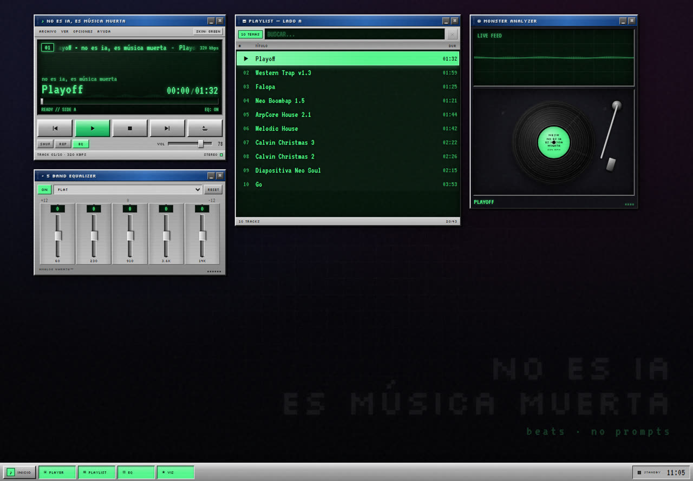

# no es ia, es música muerta

Un álbum web para escuchar los temas con una interfaz vintage inspirada en Winamp 2.x: ventanas arrastrables, display LCD, spectrum analyzer, vinilo girando, playlist, ecualizador de 5 bandas y cuatro skins.



## Tracks

| # | Tema | Duración |
|---|------|----------|
| 01 | Playoff | 01:32 |
| 02 | Western Trap v1.3 | 01:59 |
| 03 | Falopa | 01:25 |
| 04 | Neo Boombap 1.5 | 01:21 |
| 05 | ArpCore House 2.1 | 01:44 |
| 06 | Melodic House | 01:42 |
| 07 | Calvin Christmas 3 | 02:22 |
| 08 | Calvin Christmas 2 | 02:26 |
| 09 | Diapositiva Neo Soul | 02:15 |
| 10 | Go | 03:53 |

## Correr local

No hace falta instalar dependencias. Necesitás Node.js 18 o superior.

```bash
npm start
```

Después abrí [http://localhost:3000](http://localhost:3000).

También podés levantarlo directo con:

```bash
node server.js
```

El servidor sirve los archivos estáticos y soporta `Range requests`, así que el seek de los MP3 funciona bien.

## Controles

| Tecla | Acción |
|-------|--------|
| `Space` | Play / pause |
| `←` / `→` | Retroceder / avanzar 5 segundos |
| `↑` / `↓` | Subir / bajar volumen |
| `N` / `P` | Tema siguiente / anterior |
| `S` | Shuffle |
| `R` | Repetir (off → all → one) |
| `E` | Prender / apagar EQ |
| `M` | Mute |
| `T` | Cambiar skin |
| `?` | Mostrar ayuda |

También podés arrastrar las ventanas desde la barra de título, minimizarlas desde `_` / `×`, y restaurar todo desde la barra de tareas o el botón **INICIO**. Doble clic en una barra de título devuelve esa ventana a su lugar.

## Estructura

```text
.
├── audio/            # MP3 del álbum
├── css/style.css     # toda la interfaz retro
├── docs/preview.jpg  # captura para el README
├── fonts/            # fuentes locales + licencias OFL
├── js/app.js         # reproductor, playlist, EQ y visualizador
├── index.html
├── server.js         # server estático sin dependencias
├── package.json
└── .replit           # configuración para Replit
```

## Subir a GitHub

El repo ya está inicializado y con el primer commit hecho. Para conectarlo:

```bash
git remote add origin https://github.com/JuanRoccia/beats-no-prompts.git
git branch -M main
git push -u origin main
```

## Conectar con Replit

1. En Replit, elegí **Import from GitHub** y pegá el repo.
2. Replit va a leer `.replit` y ejecutar `node server.js`.
3. Abrí la Webview. El server escucha en el puerto `3000` (`process.env.PORT` también funciona).
4. Para publicar, usá un deployment con run command `node server.js`.

## Notas de audio

- Los dos WAV originales pesaban unos 40 MB cada uno, así que los convertí a MP3 320 kbps para que carguen rápido en la web. Los originales quedaron en `_originals/`, que está ignorado por git.
- `falopa.mp3` y `FusionFalopa_3.0.mp3` eran el mismo audio (mismo hash), así que el álbum usa una sola copia para no tener un tema repetido.
- Para cambiar un tema, editá el array `TRACKS` al principio de `js/app.js`. Cada entrada tiene `title`, `artist`, `file` y `duration`.

## Créditos

- Música: **no es ia, es música muerta**.
- Código e interfaz: hechos a mano, sin frameworks.
- Tipografías: [Silkscreen](https://fonts.google.com/specimen/Silkscreen) y [VT323](https://fonts.google.com/specimen/VT323), licencia SIL Open Font License. Las licencias están en `fonts/`.
